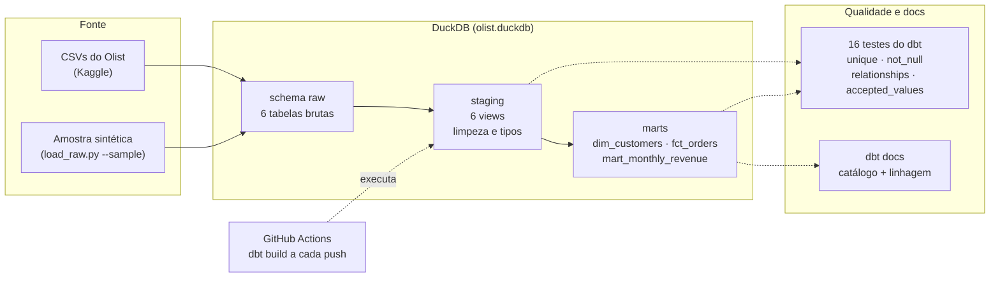
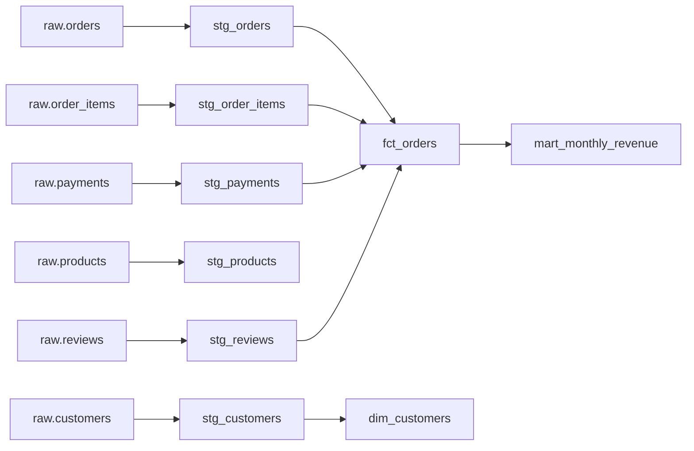

# Analytics Engineering — E-Commerce Olist (dbt + DuckDB)

[](https://github.com/GabrielKSG7/analytics-olist-dbt/actions/workflows/dbt-ci.yml)

Modelagem analítica do dataset público de e-commerce brasileiro **Olist**, no padrão
**Analytics Engineering**: camadas `staging` → `marts` com **dbt**, rodando sobre
**DuckDB** (local, sem infra), com **testes de qualidade**, **documentação/linhagem**
e **CI no GitHub Actions** a cada push.

## Perguntas de negócio respondidas
- Qual a receita por mês? Como evolui ao longo do tempo?
- Qual o tempo médio de entrega e a taxa de entregas no prazo?
- Qual a nota média de avaliação dos clientes?

## Stack
dbt-core 1.12 · dbt-duckdb · DuckDB · SQL · Python · GitHub Actions

## Arquitetura



No CI, a camada `raw` é carregada com a amostra sintética, então o pipeline roda
e testa tudo sem depender do download do Kaggle.

## Linhagem dos modelos

Gerada a partir do `manifest.json` do dbt:



`stg_products` ainda não alimenta nenhum mart: é a base para um futuro
`dim_products` e a receita por categoria.

## Modelos
```
models/
├── staging/   # 1:1 com a fonte, limpeza e padronização (views)
│   ├── stg_orders, stg_customers, stg_order_items,
│   └── stg_products, stg_payments, stg_reviews
└── marts/     # modelagem dimensional (tabelas)
    ├── dim_customers
    ├── fct_orders            # grão = pedido (receita, entrega, avaliação)
    └── mart_monthly_revenue  # agregado pronto para dashboard
```

## Como rodar

```bash
# 1. Ambiente
python -m venv .venv && source .venv/bin/activate   # Windows: .venv\Scripts\activate
pip install -r requirements.txt

# 2a. Testar já com dados de amostra (sem baixar nada)
python load_raw.py --sample

# 2b. Ou usar os dados reais: baixe o Olist do Kaggle e ponha os CSVs em data/
#     https://www.kaggle.com/datasets/olistbr/brazilian-ecommerce
# python load_raw.py

# 3. Rodar o pipeline dbt (modelos + testes)
dbt build --profiles-dir .

# 4. Documentação + linhagem
dbt docs generate --profiles-dir .
dbt docs serve --profiles-dir .   # abre no navegador
```

## Qualidade de dados
16 testes do dbt em chaves e domínios: `unique`, `not_null`, `relationships`
(FK de `fct_orders` para `dim_customers`) e `accepted_values` (status do pedido).
O CI roda todos a cada push e a cada pull request.
